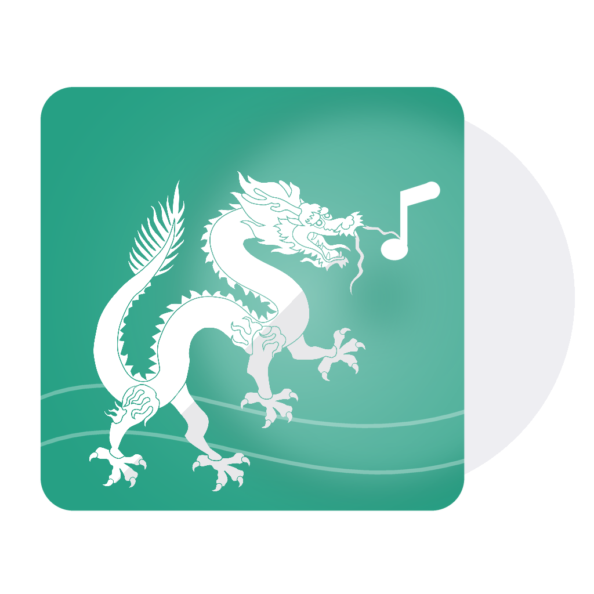
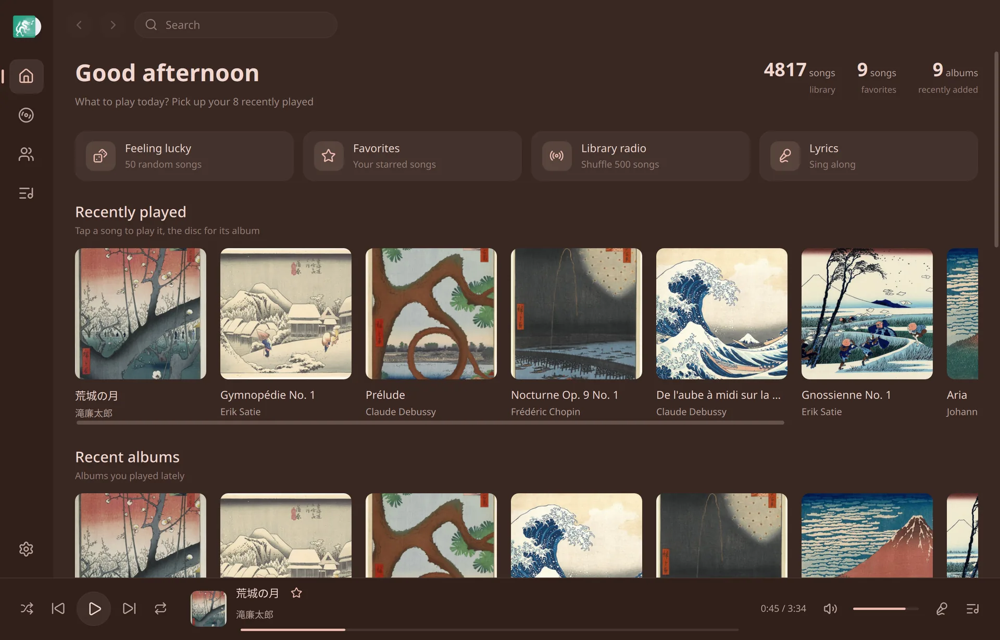

= Ryūgin 龍吟

A Navidrome player for Linux and Sailfish OS, focused on your Navidrome collection: a fork of https://github.com/imsyy/SPlayer[SPlayer] rewritten in Go + QML.
Ryūgin, "the dragon's song", is the Zen word for a deep, resonant sound.

== 🚀 Install

Every file is in https://github.com/apt-get-update/ryugin/releases[the releases]. 2.0.0 is in beta: the Sailfish OS app is now native (Silica), and needs more testing.

=== Arch Linux

[source,sh]
----
sudo pacman -U https://github.com/apt-get-update/ryugin/releases/download/v2.0.0-beta1/ryugin-2.0.0beta1-1-x86_64.pkg.tar.zst
----

Or build it: `git clone https://github.com/apt-get-update/ryugin && cd ryugin && make arch-install`.

=== Sailfish OS

Ryūgin has a native Sailfish interface, built on https://github.com/patrickjquinn/shipwright-open[Keel] (Silica on Qt 6).
On the phone, once: install https://reefstore.app[Reef], which adds Keel's repository, and in Settings → Developer tools turn on developer mode (it sets the root password).
Then, in the Terminal app:

[source,sh]
----
devel-su    # root: the password set above
# Chum, the community repo, for Qt 6
r=$(. /etc/os-release; echo "$VERSION_ID" | cut -d. -f1,2)_aarch64
ssu ar chum https://repo.sailfishos.org/obs/sailfishos:/chum/$r/
ssu ar chum-testing https://repo.sailfishos.org/obs/sailfishos:/chum:/testing/$r/
pkcon refresh
# Ryūgin (Keel comes with it, from Reef's repository)
curl -LO https://github.com/apt-get-update/ryugin/releases/download/v2.0.0-beta1/ryugin-2.0.0-beta1.aarch64.rpm
pkcon install-local ryugin-*.rpm
----

=== Other Linux

Needs Go 1.27, a C++ compiler and Qt 6: base, declarative, multimedia (FFmpeg backend), imageformats.

[source,sh]
----
git clone https://github.com/apt-get-update/ryugin && cd ryugin
go build -trimpath -ldflags "-s -w -X main.version=$(git describe --tags)" -o ryugin .
./ryugin    # finds ./qml next to the binary
----

Then start Ryūgin: it asks for your Navidrome address, user and password. Only a salted token is saved, in `~/.config/ryugin/` (Sailfish OS: `~/.config/dragon/ryugin/`).

== ✨ Features

* *Your library first*: the songs you played lately, then recent, most played, favorite and new albums. A new Navidrome scan shows up by itself.
* *Fullscreen player*: the queue and synced lyrics, word by word when the lyrics carry word times (click the cover or kbd:[Ctrl+L]).
* *Colours that follow the cover*, stars, a tray icon, a global menu, MPRIS for media keys and shell widgets, the mouse wheel on the volume.
* *On Sailfish OS*: a native Silica app. The playing cover becomes the app's ambience, and the home screen's card has play/pause and next.

[cols="2*a",frame=none,grid=none]
|===
|image::docs/screenshots/album.webp[An album]
|image::docs/screenshots/playing.webp[Synced lyrics]
|===

[cols="3*a",frame=none,grid=none]
|===
|image::docs/screenshots/phone-home.webp[The phone's home page]
|image::docs/screenshots/phone-album.webp[An album on the phone]
|image::docs/screenshots/phone-playing.webp[Playing on the phone]
|===

== 🛠️ Development

[source]
----
app/                 Go: Qt and the QML engine (main.go), MPRIS (mpris.go), the global
                     menu (menu.go), tray, cover colours, the stream relay + song cache
qml/                 the desktop UI, the Subsonic API (Api.qml), playback (Player.qml), shaders
qml-sailfish/        the Sailfish OS UI (Silica on Keel), on qml/'s API and playback
packaging/arch/      PKGBUILD, .desktop
packaging/sailfish/  build.sh, spec, .desktop, icons
tests/               run.sh, silica.sh (on the phone), the mock Navidrome, QML tests
art/                 the icon's source (icon.py)
docs/                screenshots, coverage badge
----

`make` lists the targets: `make arch-install` (the release), `make arch-git-install` (`ryugin-git`, your working tree), `make phone-install PHONE=…`, `make test`, `make shaders`.
The Sailfish OS package needs the Sailfish SDK in `~/SailfishOS`, `aarch64-linux-gnu-gcc` and `rpm-tools`; `make phone-install PHONE=…` builds it and installs it over SSH.

Tests: `make test` (needs `golangci-lint`). Lint with no warning, the Go and QML tests against a mock Navidrome, headless, and the real program; any QML warning fails, and the Go coverage must be 100 %.
On the phone (unlocked): `tests/silica.sh PHONE [Page…]` runs it from this PC and saves a picture of each page; `make bench PHONE=…` opens and closes pages and logs the slow frames.

== 📜 Credits

The design, layouts and much of the code follow https://github.com/imsyy/SPlayer[SPlayer] by imsyy; the lyrics and the fluid background follow https://github.com/amll-dev/applemusic-like-lyrics[AMLL].
The icon's dragon is https://commons.wikimedia.org/wiki/File:Chinese_black_dragon.svg[Chinese black dragon.svg] (Wikimedia Commons, CC BY-SA 3.0); the icon is under the same licence (`art/icon.py` makes it).
The screenshots show public-domain music and prints by Hokusai and Hiroshige as covers.

== 📄 License

AGPL-3.0-or-later (link:LICENSE[]), like SPlayer and AMLL it builds on.
